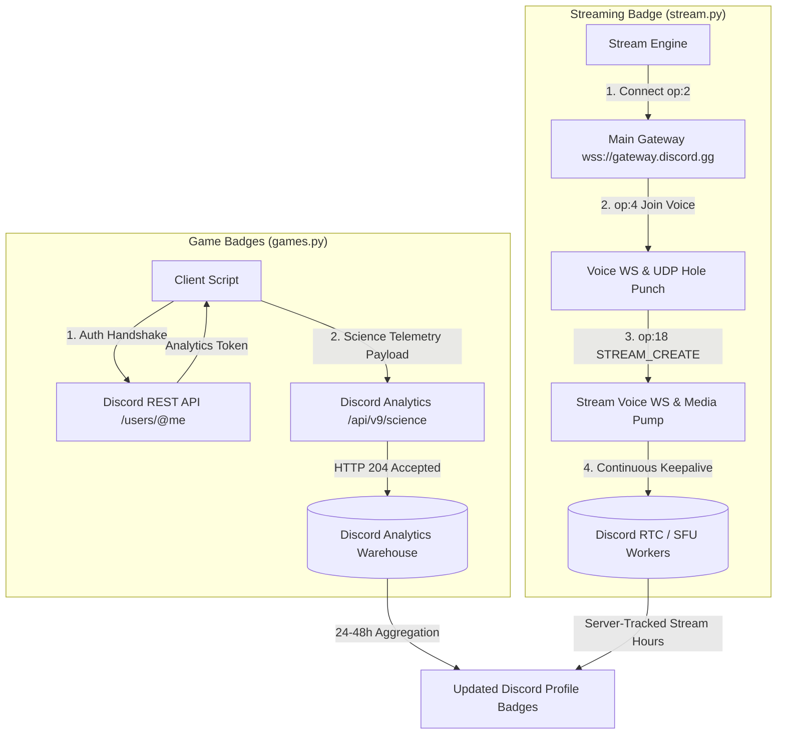

<div align="center">

# Discord Badge Maximizer — with Discord Bot Control

**A lightweight, pure Python telemetry and activity engine for Discord profile badges**

<p align="center">
  <a href="https://discord.gg/JaBugGHQ4m"></a>
  <a href="https://python.org"></a>
  <a href="LICENSE"></a>
</p>

<p align="center">
  <a href="#1-maximize-game-variety--game-time-badges-gamespy"></a>
  <a href="#1-maximize-game-variety--game-time-badges-gamespy"></a>
  <a href="#2-maximize-stream-time-badge-streampy"></a>
</p>

<p align="center">
  Programmatically level up your <b>Game Time</b>, <b>Game Variety</b>, and <b>Streaming</b> progression badges by interacting directly with Discord's analytics telemetry endpoint (<code>/api/v9/science</code>) and Voice Gateway protocol.
</p>

*Zero external dependencies • Standard library only • Multi-vector engine*

</div>

---

## Contents

- [Fork status & attribution](#fork-status--attribution)
- [What it does](#what-it-does)
- [Features and Tools 🌟](#features-and-tools-)
- [Badges Supported & Tiers](#badges-supported--tiers)
- [How to Obtain Credentials](#how-to-obtain-credentials)
  - [Step 1: Discord Account Token](#step-1-discord-account-token)
  - [Step 2: Cloudflare Clearance Cookie (`cf_clearance`)](#step-2-cloudflare-clearance-cookie-cf_clearance)
- [Step-by-Step Usage Guide](#step-by-step-usage-guide)
  - [1. Maximize Game Variety & Game Time Badges (`games.py`)](#1-maximize-game-variety--game-time-badges-gamespy)
  - [2. Maximize Stream Time Badge (`stream.py`)](#2-maximize-stream-time-badge-streampy)
  - [Live Profile & Badge Inspection (Both Scripts)](#live-profile--badge-inspection-both-scripts)
- [Discord Bot Control (`butler/`)](#discord-bot-control-butler)
- [Deployment](#deployment)
- [Known Limitations](#known-limitations)
- [Troubleshooting](#troubleshooting)
- [Security & Privacy](#security--privacy)
- [Important Disclaimer](#important-disclaimer)
- [Credits & Acknowledgments](#credits--acknowledgments)

---

## Fork status & attribution

**This repository is a modified fork maintained by
[Ankush26030](https://github.com/Ankush26030).** The badge engines are original
work by other people; this fork adds a control and hosting layer on top of them.

| | |
|---|---|
| **Original project** | Discord Badge Maximizer |
| **Original authors** | [Revere Group](https://github.com/revere-group) — core idea and structure of `games.py` · [dolfies](https://gist.github.com/dolfies) — executable-fingerprint reverse engineering · [sonujana26](https://github.com/sonujana26) — headless Gateway + Voice + Go Live engine |
| **Fork maintainer** | [Ankush26030](https://github.com/Ankush26030) — all additions and modifications listed below |
| **Original / untouched** | `games.py` telemetry payloads, `stream.py` gateway + voice + Go Live protocol, both CLI menus, badge tier data, credits |
| **Added in this fork** | `butler/` Discord bot (owner-locked slash commands, config, credential seeding, stream adapter), `main.py`, `requirements.txt`, `start_butler.bat`, `butler/DEPLOY-PTERODACTYL.md`, `butler/README.md`, this README |
| **Modified in upstream files** | `games.py`: `cf_clearance` normalization plus sending the cookie header only when present — no protocol change |
| **Not changed** | no telemetry payload, voice handshake, stream-create logic or badge tier data was rewritten |

This fork is **not affiliated with, sponsored by, or endorsed by** the original
authors. If you are an original author and want attribution adjusted or the
added layer removed, please open an issue.

---

## What it does

Discord tracks user game activity and broadcast hours to award tiered profile progression badges:

- **Game Activity Telemetry (`games.py`):** Discord's desktop client dispatches telemetry events (`launch_game` and `running_game_heartbeat`) to `/api/v9/science`. Because Discord does not run game executables on its servers, the backend trusts authenticated client reports for `duration_tracked_ms`, allowing instant claiming of 5,000+ playtime hours and 100+ games.
- **Voice Gateway & RTC Streaming (`stream.py`):** Unlike game badges, Discord's streaming badge is strictly server-verified by Discord media workers (SFU/RTC infrastructure). Client-side telemetry alone is ignored for badge accumulation. The Stream Maximizer establishes a real headless Voice + Go Live session via WebSocket and UDP protocol to accumulate genuine server-side broadcast hours.

This repository provides standalone tools to claim game badges and maintain headless 24/7 Go Live broadcasts without running resource-heavy games, GPUs, or third-party software.

---

## Features and Tools 🌟

<details open>
<summary><b>Features ✨ (Click to expand)</b></summary>

- ☑️ **Instant Game Telemetry Engine (`games.py`):** Emits authentic client-side game telemetry events directly to `/api/v9/science` to claim Tier 10 Game Time (5,000h) and Tier 10 Game Variety (100+ titles).
- ☑️ **Headless Gateway AFK Streamer (`stream.py`):** Connects directly to Discord Gateway, completes the Voice WebSocket + UDP handshake, and broadcasts Opcode 18 `STREAM_CREATE` with Opus silence keepalive frames for reliable 24/7 Go Live status with **0% CPU and 0% GPU usage**.
- ☑️ **Multi-Connection Voice Architecture:** Handles main Gateway (v9), Voice WebSocket (v7), and dedicated Stream Voice WebSocket (v7) simultaneously with active heartbeats and protocol negotiation.
- ☑️ **Automated Game Catalog Integration:** Synchronizes with Discord's detectable games list to rotate through hundreds of verified titles for the Game Variety badge.
- ☑️ **Live Profile & Badge Inspector:** Queries Discord's user profile API to display current badge tiers and equipped collectibles directly in your console.
- ☑️ **Shared Authentication State:** Saves your session securely to `session.json` so you only have to provide auth once across both scripts.
- ☑️ **Zero Dependencies:** Pure Python standard library (Python 3.10+). No `pip install` required (`cryptography` optional for encrypted RTP frames).

</details>

<details open>
<summary><b>Fork additions by Ankush26030 ✨</b></summary>

- ☑️ **Discord bot control (`butler/`):** owner-locked slash commands —
  `/claim`, `/stream start|stop|status`, `/profile`, `/auth`, `/log`,
  `/viewer join|leave`, `/status`, `/ping`, `/help`.
- ☑️ **Hosting friendly (`main.py`, `requirements.txt`):** one command
  (`python main.py`) on Pterodactyl, a VPS or any Linux container. No Windows
  requirement, no GUI.
- ☑️ **Credentials without a TTY:** account token and `cf_clearance` can live in
  `butler/config.json` or in `BUTLER_ACCOUNT_TOKEN` / `BUTLER_CF_CLEARANCE`,
  and are copied into `session.json` at startup.
- ☑️ **Cookie normalization:** paste just the `cf_clearance` value — the
  `cf_clearance=` name is added automatically, and the cookie is optional.
- ☑️ **Graceful shutdown:** panel "Stop" (SIGTERM/SIGINT) ends the stream
  session and saves the hours instead of killing the process.
- ☑️ **Docs:** this README, [`butler/README.md`](butler/README.md) and
  [`butler/DEPLOY-PTERODACTYL.md`](butler/DEPLOY-PTERODACTYL.md).

</details>

*No protocol logic was changed: claiming still runs
`games.IngestionPipeline`, streaming still runs `stream.GatewayStreamEngine`.*

---

## Badges Supported & Tiers

| Badge | Criteria | Maximum Milestone | Progression Track |
| :--- | :--- | :--- | :--- |
| ⭐ **Game Time** | Cumulative hours spent playing detectable games | **5,000+ hours** | 10 progressive tiers (Casual &rarr; Eternal) |
| ⭐ **Game Variety** | Count of unique detectable games launched | **100+ games** | 10 progressive tiers (Sampler &rarr; Universalist) |
| ⭐ **Streaming** | Hours spent streaming video in voice channels | **5,000+ hours** | 10 progressive tiers (Newcomer &rarr; Phenomenon) |

<details>
<summary><b>View Streaming Badge Tiers (Click to expand)</b></summary>

| Tier | Name | Target Hours |
| :---: | :--- | :---: |
| **1** | Newcomer | 1 hour |
| **2** | Fledgling | 5 hours |
| **3** | Breakout | 20 hours |
| **4** | Standout | 75 hours |
| **5** | Trendsetter | 150 hours |
| **6** | Headliner | 300 hours |
| **7** | Star | 500 hours |
| **8** | Sensation | 1,000 hours |
| **9** | Visionary | 2,000 hours |
| **10** | Phenomenon | 5,000 hours |

</details>

---

## How to Obtain Credentials

Before launching either tool, grab your Discord authorization token and Cloudflare cookie.

### Step 1: Discord Account Token

1. Open Discord in your web browser (Chrome, Edge, Firefox, Brave) and navigate to **[https://discord.com/channels/@me](https://discord.com/channels/@me)**.
2. Press `Ctrl + Shift + I` (or `Cmd + Option + I` on macOS) to open Developer Tools.
3. Switch to the **Network** tab at the top of Developer Tools.
4. In the filter box, type `science` or `messages?limit=10`.
   *(If the list is empty, open any Direct Message conversation or channel to generate traffic).*
5. Click on any outgoing request and navigate to the **Headers** tab.
6. Scroll down to **Request Headers** and locate **`authorization`**.
7. Copy the value of `authorization` - this is your Discord token.

---

### Step 2: Cloudflare Clearance Cookie (`cf_clearance`)

Choose either of the two methods below to copy your `cf_clearance` cookie value:

#### Method 1: Via Application Tab (Recommended & Easiest)
1. In Developer Tools (`Ctrl + Shift + I`), click on the **Application** tab (or **Storage** tab in Firefox).
2. In the left sidebar, expand **Cookies** &rarr; click on **`https://discord.com`**.
3. In the cookie table, locate the row named **`cf_clearance`**.
4. Click on `cf_clearance` and copy the value shown in the bottom inspection box.

#### Method 2: Via Network Tab
1. In Developer Tools &rarr; **Network** tab, click on any filtered `science` request.
2. Under **Request Headers**, locate the **`cookie`** entry.
3. The cookie header contains multiple values separated by semicolons. Find `cf_clearance=...;`.
4. Copy the value starting directly after `cf_clearance=` and ending right before the trailing `;` (or pass the full cookie header; both tools parse it automatically).

> [!TIP]
> Credentials are automatically saved to `session.json`. You only need to enter them once; both `games.py` and `stream.py` read from this shared session.

---

## Step-by-Step Usage Guide

Ensure Python 3.10+ is installed:
```bash
python --version
```

---

### 1. Maximize Game Variety & Game Time Badges (`games.py`)

Run the game maximizer:
```bash
python games.py
```

1. Select **Option 1**: `Claim Games (Game Time & Game Variety)`.
2. **Target games count:** Enter how many unique games you want to claim for the **Game Variety** badge (e.g. `100` to reach the maximum Tier 10 milestone, or press enter for `all`).
3. **Hours per game:** Enter the hours to allocate to each game (e.g. `50`).
4. **Badge Progression Calculation:**
   $$\text{Total Hours Credited} = \text{Total Games} \times \text{Hours per Game}$$
   *Example:* Entering **100 games** with **50 hours per game** credits **100 unique games** (Tier 10 Game Variety) and **5,000 hours** of total playtime (Tier 10 Game Time) simultaneously!

> [!NOTE]
> **Executable Fingerprint:**
> The maximizer functions completely and claims both badges **without requiring a fingerprint**. However, if you experience delayed badge updates or prefer maximum client legitimacy matching your local Windows machine, you can configure an authentic signature anytime via **Option 4** (`Configure Executable Fingerprint`).

---

### 2. Maximize Stream Time Badge (`stream.py`)

> [!NOTE]
> **Why Streaming Badges Require Gateway Broadcasting:**
> Game badges (`games.py`) are client-reported telemetry events and can be credited instantly. However, Discord's **Streaming Badge** is strictly server-verified by Discord media workers (SFU/RTC):
> - Client telemetry alone (`/science`) returns HTTP 204 but is **ignored** by the streaming badge counter.
> - The streaming badge requires an **active Voice Gateway session** with Opcode 18 `STREAM_CREATE` and continuous keepalive frames.
> - `stream.py` handles this entire handshake headlessly in pure Python with **0% GPU and minimal CPU**.

> [!IMPORTANT]
> **2 Critical Requirements for Stream Time to Accumulate:**
> 1. **At Least 1 Viewer / Alt Account in the Voice Channel:** Discord's official badge policy explicitly requires that you share your screen with **at least one other person** present in the voice channel or call. If you stream alone in an empty channel (0 viewers), Discord's backend ignores the session and **will NOT count hours** toward the badge! Keep an alt account sitting in the voice channel (muted/deafened is fine).
> 2. **Personalization Privacy Setting Enabled:** You must have **"Use data to personalize my Discord experience"** turned **ON** in your main account's settings (*User Settings ⚙ → Data & Privacy*). If this setting is disabled, Discord's analytics pipeline will not record badge progress.

Run the stream maximizer:
```bash
python stream.py
```

### Start Live Stream (Gateway AFK Go Live Broadcast)
1. Select **Option 1** from the menu.
2. Enter your **Server (Guild) ID** and **Voice Channel ID** (where your account has permission to join and stream).
3. The engine automatically executes the complete 3-connection protocol:
   - **Main Gateway (v9):** Authenticates and sends Opcode 4 (`VOICE_STATE_UPDATE`) to join the channel.
   - **Voice Gateway (v7):** Connects to the voice server, performs UDP IP Discovery, negotiates encryption, and pumps keepalive silence packets.
   - **Stream Gateway (v7):** Sends Opcode 18 (`STREAM_CREATE`), connects to the dedicated stream media server, announces 1080p screen sharing, and pumps encrypted Opus silence.
4. Your account immediately displays the purple **LIVE** badge on Discord. Leave it running in the background to accumulate streaming hours effortlessly 24/7.
5. Press **Enter** at any time to gracefully end the stream and save accumulated hours.

> [!IMPORTANT]
> ### ☁️ 24/7 AFK Cloud Hosting (Zero Device Wear & Zero Effort)
>
> Normally, acquiring Discord's Streaming Badge demands hundreds of hours of manual screen sharing or gaming in voice channels. While this tool completely eliminates that burden by spoofing the entire broadcast pipeline headlessly with 0% GPU usage, **you still need to keep your PC powered on with the script running to accumulate hours**.
>
> **Want to stream 24/7 without keeping your PC running?**
> If you'd rather sit back, hold your coffee, and let a remote server farm your hours non-stop without needing your personal device turned on, we offer **dedicated, secure 24/7 cloud hosting** with custom, ultra-affordable plans starting from just **$1**:
> - **Tailored Hour Plans:** Flexible packages matched to your target badge tier (e.g., 1-week plan for 150+ hours, 1-month plan for 700+ hours, or custom milestones).
> - **Blazing-Fast 24/7 Uptime:** Hosted on high-speed enterprise servers with guaranteed 0 downtime and zero disconnects.
> - **Full Web Control Panel:** Complete access to start, stop, monitor, or manage your stream process anytime.
>
> *Note: This hosting service is entirely optional; running the script locally on your own computer is 100% free and works perfectly while your device is on. However, if you want a set-and-forget 24/7 virtual private server experience without stressing over technical setup or device power, you are always welcome in our support server!*
>
> 💬 **[Join our Support Server](https://discord.gg/JaBugGHQ4m)** and open a ticket to get your custom hosting setup!

---

### Live Profile & Badge Inspection (Both Scripts)

> [!TIP]
> **Check Your Progress Anytime:**
> You do not need to log into Discord on another client to verify your profile badges. You can query your live Discord profile data and equipped badges at any time by selecting:
> - **Option 2** in `games.py` (`Inspect Discord Profile & Badges`)
> - **Option 2** in `stream.py` (`Inspect Discord Profile & Badges`)
>
> This queries `https://discord.com/api/v9/users/{user_id}/profile` and outputs your display name, snowflake ID, and every equipped profile badge.

---

> [!IMPORTANT]
> **Badge Synchronization Period (24h – 48h):**
> Discord does not grant progression badges in real-time. Once hours are submitted or streamed, Discord's backend data warehouse calculates badge upgrades during scheduled analytics aggregation cycles (typically within **24 to 48 hours**).

---

## Discord Bot Control (`butler/`)

A small `discord.py` bot that drives the same engines from any device. The bot
only triggers work — all telemetry and voice traffic still leaves your machine.

```
Discord  ──/claim──▶  bot  ──▶  games.IngestionPipeline  ──▶  discord.com/api/v9/science
Discord  ──/stream──▶ bot  ──▶  stream.GatewayStreamEngine ─▶  Voice WS + UDP + Go Live
```

### Bot setup

1. Create an application at <https://discord.com/developers/applications> →
   **Bot** → **Reset Token** and copy the token.
2. Invite the bot with scopes `bot` + `applications.commands` and permissions
   `View Channels`, `Connect`, `Speak`.
3. **Make the config file:** rename (or copy) `butler/config.example.json` to
   `butler/config.json`. That single rename is the only setup step — the bot
   reads `config.json` only and never touches the example file. Then fill in
   `bot_token` plus `owner_id` (your numeric user ID).
4. Add the account credentials — either run `python -m butler auth` locally, or
   put `account_token` / `cf_clearance` in the same config file.
5. Start it:

```bash
pip install -r requirements.txt
python -m butler check    # validate config, commands and game catalog
python -m butler run      # start the bot
```

On Windows you can double-click `start_butler.bat`.

> **`config.example.json` → `config.json`**
>
> The example file is a template. Rename it once:
>
> - **Panel:** Files → `butler/` → right-click `config.example.json` → **Rename** → `config.json`
> - **Local:** `cp butler/config.example.json butler/config.json` (Windows: `copy`)
>
> Only `butler/config.json` is read by the bot. Nothing else needs to be renamed
> or moved.

### Commands

| Command | Description |
|---|---|
| `/status` | auth state, claimed hours, stream state, uptime, latency |
| `/claim games:100 hours:50` | claim Game Time + Game Variety hours |
| `/stream start [guild_id] [channel_id]` | start the headless Go Live session |
| `/stream stop` | stop, persist the session and report elapsed time |
| `/stream status` | live/connecting state, elapsed time, tracked total |
| `/profile` | live profile badges |
| `/auth` | credential presence and analytics-token age |
| `/log lines:40` | tail of the bot / engine output |
| `/viewer join #channel` | make the bot sit in voice as a spectator (needs PyNaCl) |
| `/viewer leave` | disconnect the bot from voice |
| `/ping` | liveness and uptime |
| `/help` | command list |

Every command is ephemeral and restricted to `owner_id`; anybody else receives
"locked to owner".

### Bot configuration reference

Everything below lives in `butler/config.json` — the file you get by renaming
`butler/config.example.json`.

| Field | Meaning |
|---|---|
| `bot_token` | Discord application bot token |
| `owner_id` | your Discord user ID — the only account that can use commands |
| `guild_id` | server for instant slash-command sync (optional) |
| `log_channel_id` | channel for stream / claim summaries (optional) |
| `default_games` | default for `/claim games:` (100 = Tier 10 variety) |
| `default_hours` | default for `/claim hours:` (50h × 100 = 5,000h) |
| `voice_guild_id` | default server for `/stream start` |
| `voice_channel_id` | default voice channel for `/stream start` |
| `account_token` | Discord **account** token used by the engines |
| `cf_clearance` | Cloudflare clearance cookie (optional) |

Environment overrides: `BUTLER_BOT_TOKEN`, `BUTLER_OWNER_ID`,
`BUTLER_GUILD_ID`, `BUTLER_LOG_CHANNEL_ID`, `BUTLER_ACCOUNT_TOKEN`,
`BUTLER_CF_CLEARANCE`. Precedence: environment → `butler/config.json` →
`session.json`.

---

## Deployment

### Local machine

```bash
pip install -r requirements.txt
python -m butler check
python -m butler run
```

The original scripts keep working side by side: `python games.py` and
`python stream.py`.

### Pterodactyl / Linux container

1. Egg: any Python 3.10+ egg (e.g. **Python Generic**), 512 MB RAM.
2. Upload the repository contents to `/home/container` (not the folder itself).
3. Startup command: `python main.py` — or
   `pip install --no-cache-dir -r requirements.txt && python main.py`.
4. Rename `butler/config.example.json` to `butler/config.json` (panel: right-click
   → Rename) and fill in the IDs — no other file needs renaming.
5. Credentials: `account_token` / `cf_clearance` in the config, or
   `BUTLER_ACCOUNT_TOKEN` / `BUTLER_CF_CLEARANCE` environment variables.

Full walkthrough, including panel-specific pitfalls and troubleshooting:
[`butler/DEPLOY-PTERODACTYL.md`](butler/DEPLOY-PTERODACTYL.md).

---

## How It Works



---

## Known Limitations

- **Streaming is real time.** Discord's media workers measure the live session
  server-side, so one hour streamed equals one hour credited. Tier 10 (5,000h)
  is roughly 208 days of continuous hosting.
- **A viewer is required.** Keep an alt account or a friend in the voice
  channel; streaming alone does not count toward the badge.
- **Personalization must be ON.** *Settings → Data & Privacy → Use data to
  personalize my Discord experience*.
- **Go Live sessions can be dropped.** Discord may delete a stream that is not
  publishing media; the engine retries three times and then stops the session.
  Restart with `/stream start` and make sure a viewer is present.
- **Badges sync every 24–48 hours.** Discord does not grant progression badges
  in real time.
- **Local hour counters are estimates.** Only Discord's aggregation matters.
- **Panel restarts end the stream.** Start it again after a restart.
- **The Windows executable fingerprint is optional** and unavailable on Linux;
  the bot never uses it.
- **`/viewer join` needs `PyNaCl`** (`pip install PyNaCl`); without it, voice
  support is unavailable and the command explains that.

---

## Troubleshooting

| Symptom | Cause / fix |
|---|---|
| `HTTP 401` on `/claim` | account token invalid or expired — copy a fresh `authorization` header from the browser and verify it with the console snippet above |
| `/claim` returns `0 / N` | token or `cf_clearance` rejected; refresh the credentials |
| `target rejected` on `/stream start` | wrong channel ID, or the account lacks Connect / Stream permission |
| `stream stopped by server` repeatedly | no viewer in the channel, or Discord rejected the session; retry with a viewer present |
| Slash commands missing | `guild_id` unset (global sync can take up to 1h), or the bot is not in that server |
| `ModuleNotFoundError: discord` | `pip install -r requirements.txt` |
| `python: not found` on a panel | use `python3 main.py` |
| Garbled symbols in bot replies | replace `butler/bot.py` with the current version (encoding fix) |
| Panel: "configuration incomplete" | `butler/config.json` missing or invalid JSON |
| `/viewer join` asks for PyNaCl | `pip install PyNaCl` |

Logs: `/log lines:40` in Discord, or the panel console.

---

## Security & Privacy

- The **account token** is sent only to `discord.com` (REST + gateway) and to
  the voice / stream endpoints that Discord itself returns. Nothing goes to any
  other host.
- The only third-party request is `cordapi.dolfi.es`, a `POST {}` that returns
  client properties. It receives **no token, cookie or user ID**; the code
  falls back to local properties if it is unreachable.
- No webhooks, analytics SDKs or "phone home" behaviour.
- Secrets live in `session.json` and `butler/config.json` (both gitignored). A
  hosting provider with container access can read them — use an alt account on
  shared hosting, or your own VPS.
- The bot never accepts tokens or cookies through Discord commands, and
  `/auth` only reports presence, never values.
- Rotate the account token after testing on a shared host.

---

## Important Disclaimer

> [!WARNING]
> This project is created for educational and security research purposes only. Automating user account telemetry and spoofing activity metrics violates Discord's Terms of Service. Use at your own discretion on accounts you are comfortable risking.

---

## Credits & Acknowledgments

> **Original Source Code** — Discord Badge Maximizer, by Revere Group, dolfies & sonujana26
>
> This project is a heavily modified and extended fork of the original Discord
> Badge Maximizer. All core architecture, engine design and badge logic belong
> to the original authors. Go star their work if you appreciate it.

| Who | Role |
|---|---|
| [Revere Group](https://github.com/revere-group) | Original `games.py` — core idea and structure |
| [dolfies](https://gist.github.com/dolfies) | Executable fingerprint reverse engineering used by `games.py` |
| [sonujana26](https://github.com/sonujana26) | Original `stream.py` — headless Gateway + Voice + Go Live engine |
| [Ankush26030](https://github.com/Ankush26030) | Fork maintainer — all extra modifications: Discord bot (`butler/`), hosting support, documentation |

### Extra modifications by [Ankush26030](https://github.com/Ankush26030)

- `butler/` — owner-locked Discord bot with slash-command control
- `main.py`, `requirements.txt`, `start_butler.bat` — hosting entry points
- `games.py` — `cf_clearance` normalization and optional cookie header
- Credential seeding from config/env vars, plus graceful shutdown on panel stop
- `README.md`, `butler/README.md`, `butler/DEPLOY-PTERODACTYL.md`

*No telemetry payload, voice handshake or stream-create logic was rewritten —
those remain the original authors' work.*

---

<div align="center">

[](https://discord.gg/JaBugGHQ4m)
[](https://discord.com/invite/w77ymEU82a)

Released under the [MIT License](LICENSE).

</div>
